# BÁO CÁO CUỐI KỲ — MYMINICLOUD

**Bản kiểm chứng LOCAL — chưa triển khai AWS EC2**

Môn học: Điện toán đám mây.

Sinh viên: **Võ Thị Thiên Kim — 521H0092**; **Diệp Yến Nhi — MSSV chờ bổ sung**.

Ngày ghi nhận kết quả: **26/10/2026**, múi giờ Việt Nam. Mỗi log JSON có thời điểm kiểm thử UTC riêng để đối chiếu.

Repository: https://github.com/Katie-217/MiniCloud

Tài liệu này ghi kết quả thực tế trên Docker Desktop Linux engine. Phần AWS và video EC2 còn thiếu; tài liệu cần cập nhật trước khi nộp bản cuối. Đã thực hiện **0/10 mục mở rộng**; `/secure` mới có cấu hình kiểm tra token và test từ chối token thiếu/sai, chưa hoàn thành luồng E04.

## Chương 1. Giới thiệu và mục tiêu

### 1.1. Bài toán

Xây dựng mô phỏng hạ tầng cloud thu nhỏ MyMiniCloud gồm Web, Application, Database, Authentication, Object Storage, Internal DNS, Monitoring, Visualization và Reverse Proxy. Mỗi thành phần chạy trong container riêng và tham gia mạng `cloud-net`.

Mô hình có 9 loại server và 10 container chạy thường trực do Monitoring sử dụng thêm Node Exporter, đúng cấu trúc Compose của hướng dẫn chi tiết. Đây là hạ tầng mô phỏng trên một máy, chưa có độ sẵn sàng cao hay điều phối nhiều node.

### 1.2. Mục tiêu kiểm chứng

- Web phục vụ Home/Blog; Flask cung cấp API trực tiếp và qua proxy, đọc dữ liệu MariaDB thật.
- Keycloak có admin đăng nhập và user sv01; MinIO upload/download; Bind9 trả bản ghi theo đề.
- Prometheus thu thập metrics; Grafana hiển thị CPU/RAM/Network.
- Container cùng mạng, restart policy hợp lệ; dữ liệu lưu được sau khi tạo lại container.
- Image Web tùy chỉnh được publish Docker Hub. AWS chờ setup từ người dùng.

## Chương 2. Kiến trúc và sơ đồ


### 2.1. Luồng request

1. Trình duyệt gọi gateway `http://localhost/`, gateway chuyển tới Web Nginx.
2. `/api/hello` chuyển thành Flask `/hello`; `/api/notes` đọc bảng notes bằng tài khoản DB ứng dụng, không dùng root.
3. `/auth/` được giữ nguyên đường dẫn khi chuyển tới Keycloak. Context path phía Keycloak cũng là `/auth`.
4. Prometheus scrape Node Exporter mỗi 15 giây. Grafana truy vấn Prometheus bằng tên service nội bộ.
5. MinIO và Bind9 có bài kiểm thử độc lập. Bản ghi IP 10.10.10.10 trong zone là IP ví dụ theo đề; không tự gán IP đó cho Web container.

### 2.2. Ánh xạ cổng

| Dịch vụ | Cổng host → container | Vai trò |
|---|---|---|
| Gateway | 80 → 80 | Web/App/Auth qua điểm vào chung |
| Web | 8080 → 80 | Home và Blog |
| App | 8085 → 8081 | Flask API |
| MariaDB | 127.0.0.1:3306 → 3306 | CSDL quan hệ |
| Keycloak | 8081 → 8080 | Quản trị tại /auth/ |
| MinIO | 9000 / 9001 | S3 API / Console |
| Bind9 | 1053 → 53 UDP/TCP | DNS lab |
| Node Exporter | 127.0.0.1:9100 → 9100 | Metrics |
| Prometheus | 9090 → 9090 | Thu thập và truy vấn |
| Grafana | 3000 → 3000 | Dashboard |

## Chương 3. Cấu hình và Dockerfile

### 3.1. Docker Compose

`docker-compose.yml` đặt tên project `myminicloud`, khai báo mạng `cloud-net` và tên container riêng. Các service kế thừa `restart: unless-stopped`, network và cấu hình xoay log. Healthcheck được dùng trong `depends_on` để chờ dịch vụ sẵn sàng. Mật khẩu được sinh vào `.env` local bởi `scripts/setup.py` và không nằm trong Git.

Named volumes lưu dữ liệu MariaDB, Keycloak, MinIO, Prometheus và Grafana. Không dùng thao tác xóa volume để khởi tạo lại khi kiểm thử.

### 3.2. Web, App và DB

- `web-frontend-server/Dockerfile`: dựa trên Nginx Alpine, copy config và HTML. `/blog/` dùng alias có dấu `/` cuối như hướng dẫn.
- `application-backend-server/Dockerfile`: Python 3.11 Alpine, cài requirements, chạy Gunicorn dưới user không đặc quyền. API giữ nội dung JSON `/hello` theo đề; `/notes` thể hiện kết nối DB thật.
- SQL `relational-database-server/init/001_init.sql` tạo database minicloud, bảng notes và seed `Hello from MariaDB!`. Sau test persistence có thêm một bản ghi đánh dấu kiểm thử.

### 3.3. Auth, Storage và DNS

- Keycloak dùng image 26.1.4, `start-dev`, context path `/auth`; script kiểm thử đăng nhập admin và tạo user sv01. Volume giữ dữ liệu H2 của bài lab.
- MinIO build từ source chính thức tag RELEASE.2025-04-22T22-12-26Z, kiểm tra SHA256 archive. Cách này thay thế các image/download đã không còn truy cập được khi thực hiện; LICENSE được giữ trong image. Console đầy đủ đã được kiểm thử.
- Bind9 dùng ba file theo đề và một named.conf include rõ ràng; UDP/TCP 1053 công bố ra host. Zone có bản ghi Web 10.10.10.10.

### 3.4. Monitoring và Gateway

Prometheus job node trỏ `monitoring-node-exporter-server:9100`. Grafana được provision datasource và Node Exporter Full revision 37, giữ tác giả/license template. Trên Docker Desktop, CPU/RAM là số liệu Linux VM; network phản ánh namespace exporter quan sát được. Root filesystem và một số panel tùy chọn có thể N/A; ba nhóm CPU/RAM/Network chính có dữ liệu.

Gateway Nginx có upstream với Docker DNS resolver để cập nhật IP sau khi container được tạo lại. `/api/` bỏ tiền tố; `/auth/` giữ tiền tố và truyền các header forwarded phù hợp. `/auth/` trả redirect 302; URL issuer kiểm chứng là `http://localhost/auth/realms/master`.

## Chương 4. Demo và kiểm thử

### 4.1. Kết quả chức năng local

| Nhóm | Kỳ vọng | Kết quả thực tế / bằng chứng |
|---|---|---|
| Compose | Toàn bộ server chạy, chung mạng, restart đúng | 10 container healthy; R01-stack.json |
| Web | Home/Blog HTTP 200 | Cả hai đạt; R02-web.json |
| App | Hello JSON đúng, trực tiếp/qua proxy | Cả hai đạt; R03-api.json |
| Database | notes và seed tồn tại | Query đạt; R04-database.json; App đọc DB đạt |
| Auth | Admin login, tạo sv01 | API và trình duyệt đạt; R05-auth.json |
| Storage | Bucket demo, upload/download | Hai chiều khớp SHA256 và bytes; R06-storage.json |
| DNS | Web trả 10.10.10.10 | Đạt qua nội bộ và host 1053; R07-dns.json |
| Prometheus | Target node UP, metrics có dữ liệu | Đạt; R08-monitoring.json |
| Grafana | CPU/RAM/Network hiển thị | Đạt qua query và ảnh UI; R09-grafana.json |
| Proxy | Web/API/Auth route đúng | 200 / JSON / 302, issuer đúng; R10-gateway.json |
| Network | Ping các server thành công | 3 gói/service, cả 10 service 0% loss; R11-network.json |
| Persistence | Tạo lại container không mất dữ liệu | 5 container ID đổi, dữ liệu vẫn còn; R12-persistence.json |
| Docker Hub | Có image tùy chỉnh | katie217/myminicloud-web:1.0.0; R13-dockerhub.json |
| AWS EC2 | Toàn hệ thống chạy public IP | Chưa làm theo chỉ dẫn chờ AWS từ người dùng |

### 4.2. Ảnh minh chứng

Ảnh log bên dưới được tạo từ kết quả kiểm thử đã lưu, không dùng ảnh mẫu của đề. Các ảnh giao diện Web/Keycloak/MinIO/Prometheus/Grafana được chụp từ hệ thống thực đang chạy.

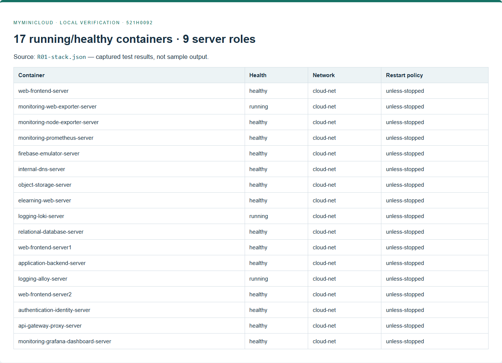

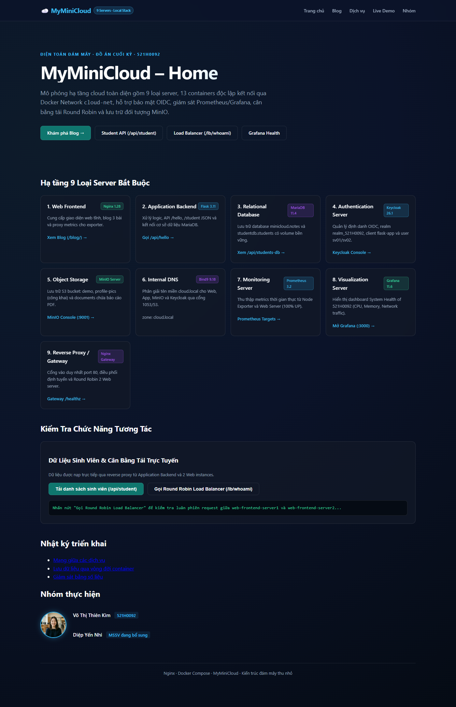

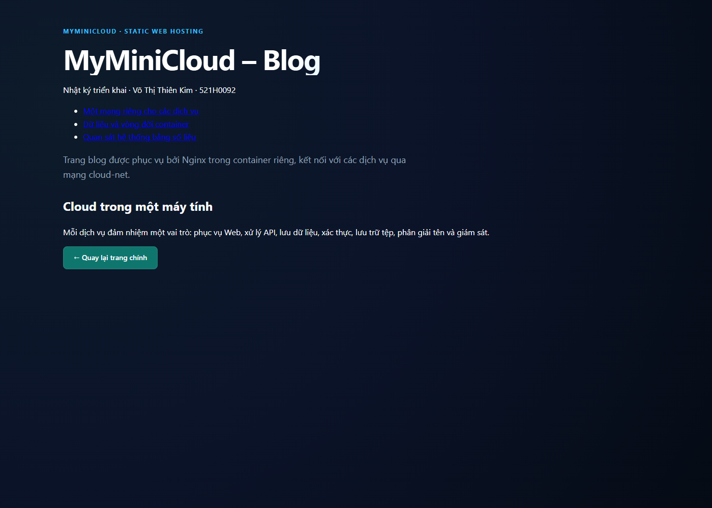

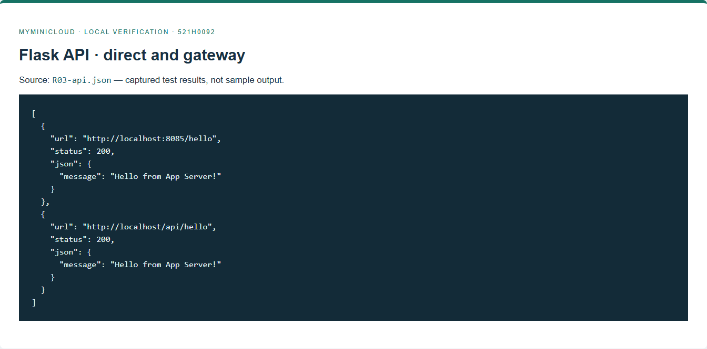

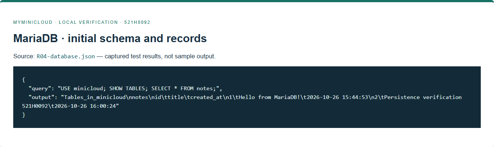

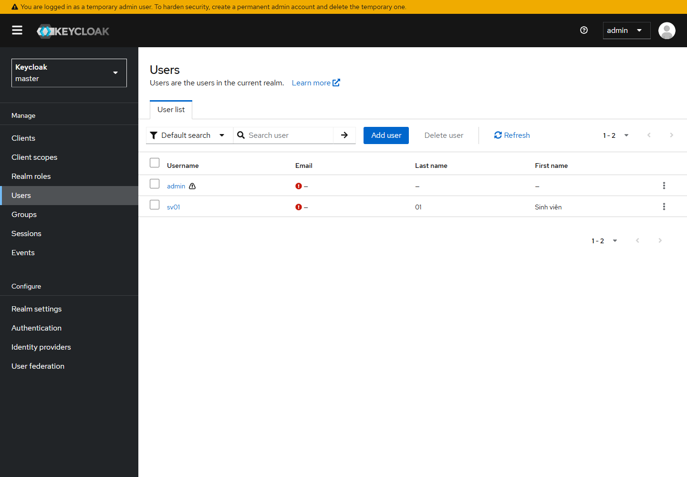

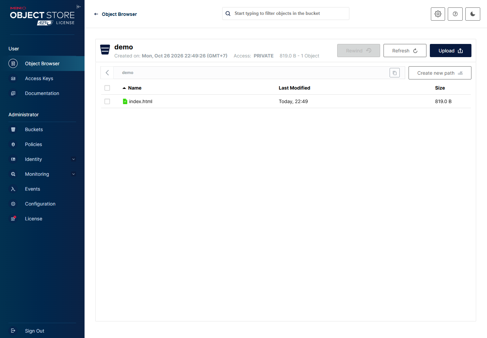

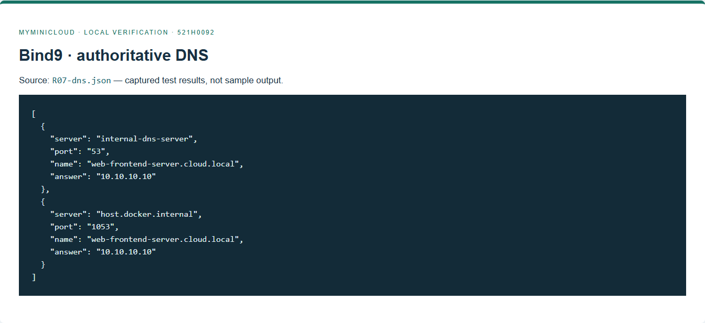

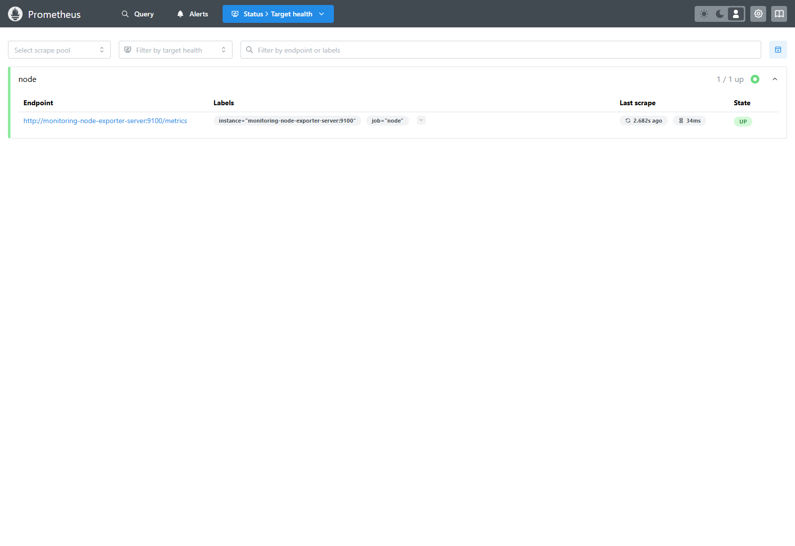

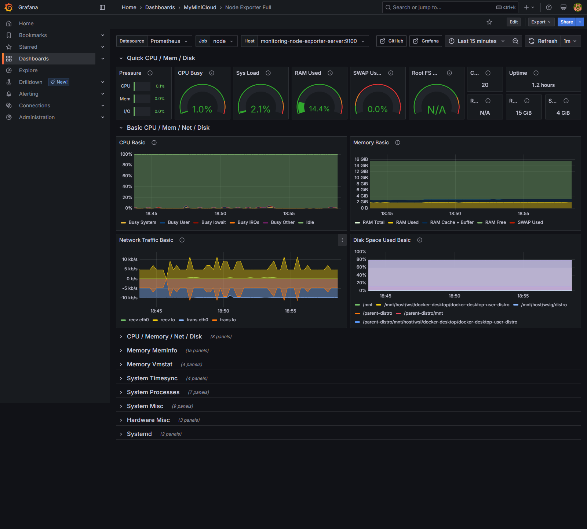

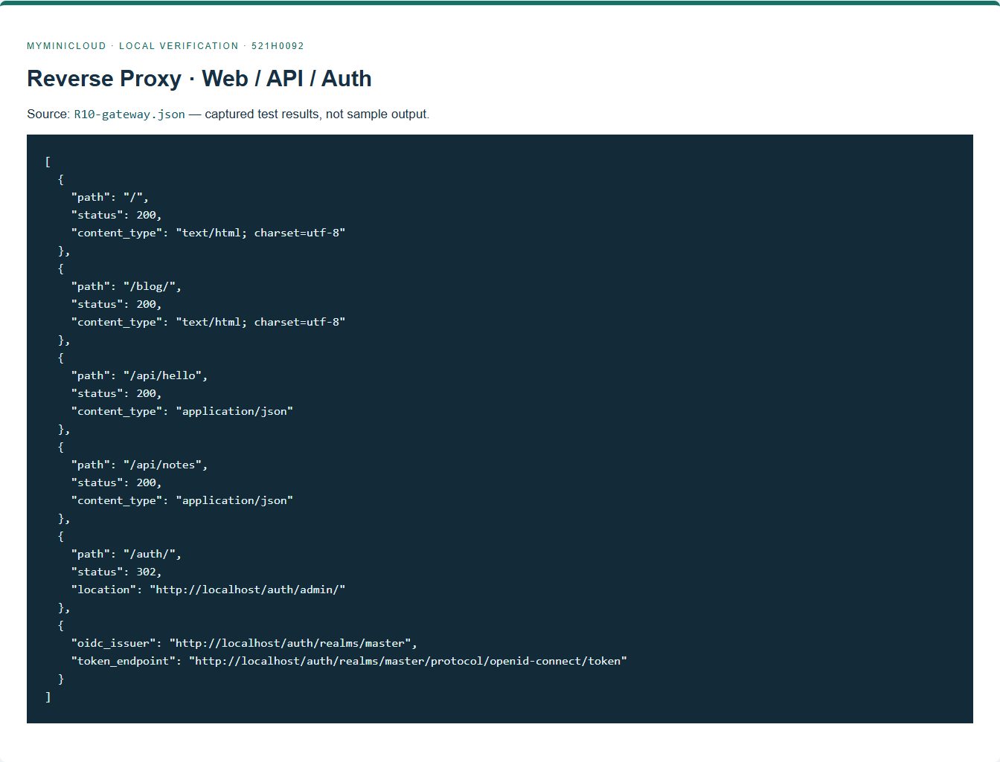

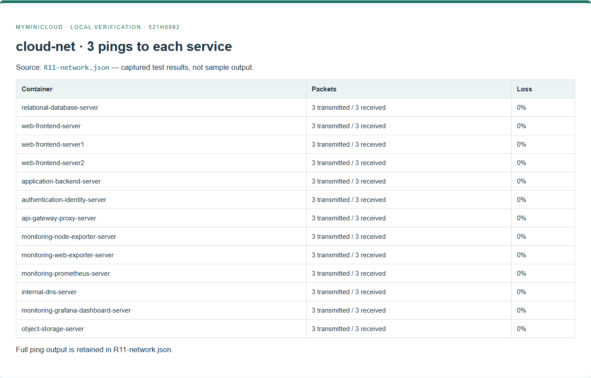

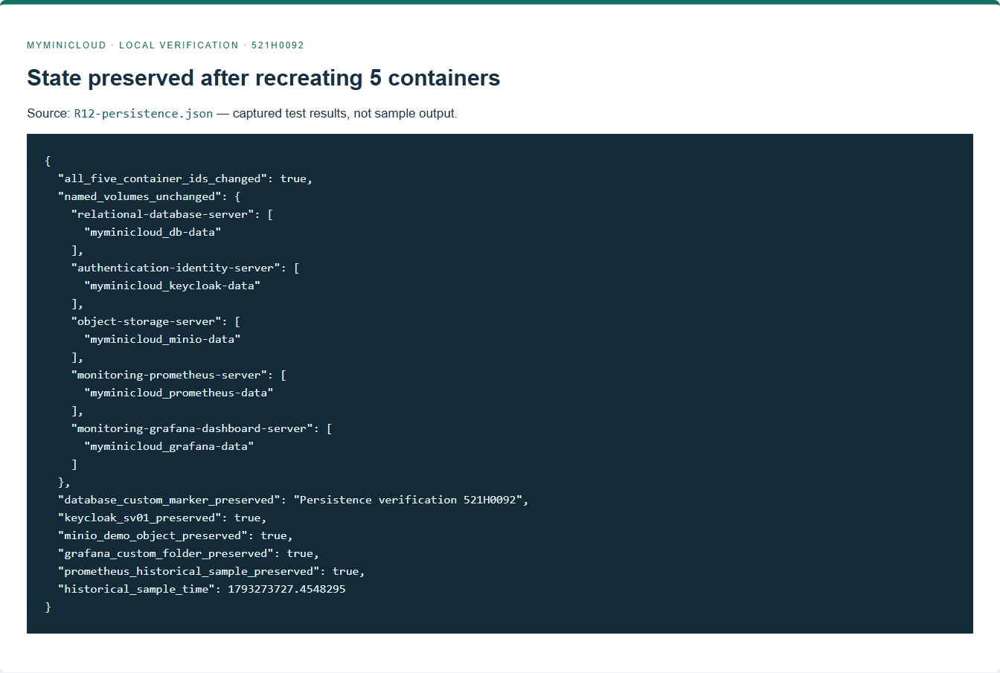

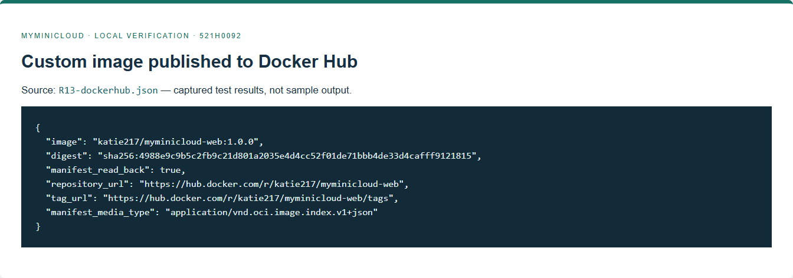

### 4.3. Cách chạy lại kiểm thử

```powershell
docker compose up -d --build --wait
docker build -t myminicloud-tools:local tools
.venv/Scripts/python scripts/check_all.py --screenshots
```

Kiểm thử persistence riêng: `.venv/Scripts/python scripts/check_persistence.py`. Lệnh này chỉ tạo lại 5 container lưu dữ liệu của MyMiniCloud, giữ nguyên volume; có bổ sung bản ghi DB và folder Grafana để chứng minh dữ liệu không bị tạo lại từ seed.

### 4.4. Các mục mở rộng

Hiện **0/10 mục**. Blog mới có trang chỉ mục cơ bản; chưa có 3 bài mở rộng. Chưa có JSON 5 sinh viên, studentdb, realm MSSV/client flask-app/token hợp lệ, avatar public/documents PDF, DNS bổ sung, metrics Web, dashboard cá nhân, route student hoặc Round Robin. Việc có `/notes` và `/secure` không được tính thay cho các yêu cầu này.

## Chương 5. Đánh giá và phân tích

### 5.1. Kết quả và ưu điểm

Phần chức năng bắt buộc trên local đã có kiểm thử thực tế và script chạy lại. Cấu hình tách service rõ ràng; healthcheck, named volume, tài khoản DB ứng dụng và mật khẩu ngoài Git giúp vận hành demo thuận tiện. Git giữ từng branch nhóm và các commit chức năng nhỏ; commit từ thời điểm chốt quy ước mới dùng tiếng Anh.

### 5.2. Khó khăn và cách xử lý

| Vấn đề | Cách xử lý và kiểm chứng |
|---|---|
| Cổng App/Auth và tên service khác nhau giữa các trang đề | Thống nhất theo Compose: App 8085, Auth 8081; dùng tên service dài |
| Mẫu ghi 9 container nhưng có Node Exporter | Báo cáo đúng 9 vai trò / 10 container |
| MinIO registry/archive không tải được | Build từ source chính thức có SHA256, kiểm thử Console và S3 |
| Docker Desktop không hỗ trợ rslave cho mount root này | Bỏ propagation rslave, giữ read-only và proc/sys mounts; query metrics đạt |
| Proxy Auth có thể sai context path | Thống nhất /auth ở hai phía; kiểm tra UI và issuer |
| Container tạo lại có IP khác | Upstream resolve bằng Docker DNS; kiểm tra proxy sau recreate |

### 5.3. Hạn chế và phần còn thiếu

- Chưa có EC2/public IP và minh chứng cloud; đây là yêu cầu bắt buộc còn thiếu.
- MSSV Diệp Yến Nhi cần bổ sung trước khi nộp.
- Metrics chưa cung cấp giám sát mọi container; chưa có logging tập trung Loki. Theo test chi tiết của đề, Grafana dùng dữ liệu Prometheus; log container được lưu riêng và đã loại mật khẩu.
- Bản local dùng HTTP và Keycloak dev; chưa phải cấu hình vận hành production.
- Video local và đường dẫn nằm trong phụ lục; cần bổ sung phần EC2 rồi hoàn thiện hồ sơ cuối.
- Chưa thực hiện 10 mục mở rộng. Các kết quả local không được tính tự động là kết quả EC2.

### 5.4. Hướng tiếp tục

Khi người dùng chuẩn bị AWS, triển khai cùng source trên EC2 Ubuntu, cập nhật origin/hostname, kiểm thử đủ từng server qua SSH và public endpoint, chụp bằng chứng EC2, cập nhật báo cáo/video. Sau khi khép toàn bộ phần bắt buộc mới làm mở rộng theo bảng tiến độ.

## Phụ lục

- Source và lịch sử branch: https://github.com/Katie-217/MiniCloud
- Docker Hub: https://hub.docker.com/r/katie217/myminicloud-web
- Image tag: `katie217/myminicloud-web:1.0.0`; digest chính xác trong `evidence/local/R13-dockerhub.json`.
- Video local: [Demo_Local_521H0092.webm](Demo_Local_521H0092.webm). Link repo sau khi push: https://github.com/Katie-217/MiniCloud/blob/main/report/Demo_Local_521H0092.webm
- Log/JSON/ảnh: `evidence/local/`; `service-logs.txt` đã loại mật khẩu; `image-inventory.json` ghi image ID/digest đang chạy.
- Bảng theo dõi: `TIEN_DO_OUTPUT.md`. AWS và hồ sơ cuối chưa được đánh dấu hoàn thành.
- Đề gốc: Báo Cáo Cuối Kỳ.docx.pdf, trang 1–3, 11–20 và 21–27.
- Tài liệu cấu hình tham khảo: https://docs.docker.com/compose/how-tos/startup-order/ ; https://www.keycloak.org/server/reverseproxy ; https://github.com/prometheus/node_exporter#docker ; https://grafana.com/docs/grafana/latest/administration/provisioning/ .
