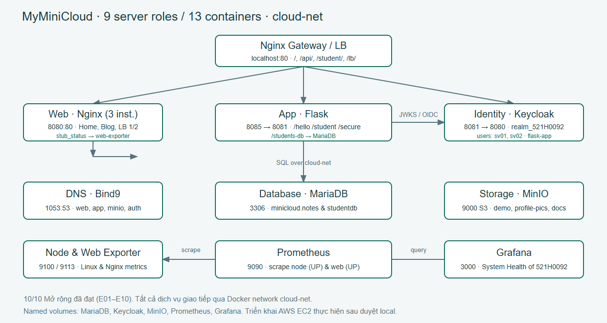

# BÁO CÁO CUỐI KỲ — MYMINICLOUD

**Bản kiểm chứng LOCAL — Hoàn thành 14/18 nhóm bắt buộc & 10/10 mục mở rộng**

Môn học: **Điện toán đám mây**.

Sinh viên: **Võ Thị Thiên Kim — 521H0092**; **Diệp Yến Nhi — MSSV chờ bổ sung**.

Ngày ghi nhận kết quả: **27/10/2026**, múi giờ Việt Nam. Mỗi log JSON có thời điểm kiểm thử UTC riêng để đối chiếu.

Repository: https://github.com/Katie-217/MiniCloud

Tài liệu này ghi nhận kết quả kiểm thử thực tế trên hệ thống container Docker Desktop Linux Engine (Server Version 29.0.1). Toàn bộ 10/10 mục mở rộng (E01–E10) và các nhóm chức năng cơ bản đã được kiểm chứng đạt (DAT). Phần triển khai AWS EC2 và video trên cloud được bảo lưu thực hiện sau khi người dùng kiểm tra và xác nhận bản bàn giao local đạt theo đúng quy ước làm việc.

---

## Chương 1. Giới thiệu và mục tiêu

### 1.1. Bài toán

Xây dựng mô phỏng hạ tầng cloud thu nhỏ **MyMiniCloud** gồm đầy đủ 9 vai trò máy chủ cơ bản:
1. **Web Frontend Server** (Nginx)
2. **Application Backend Server** (Python Flask)
3. **Relational Database Server** (MariaDB)
4. **Authentication & Identity Server** (Keycloak)
5. **Object Storage Server** (MinIO S3)
6. **Internal DNS / Name Service** (Bind9)
7. **Monitoring Server** (Prometheus & Node Exporter & Nginx Exporter)
8. **Logging / Visualization Server** (Grafana)
9. **Reverse Proxy / Load Balancer** (Nginx API Gateway)

Mỗi thành phần chạy trong container riêng biệt, cô lập, có tên định danh rõ ràng, chính sách khởi động lại `unless-stopped` và kết nối chung qua Docker Network `cloud-net`. Hệ thống gồm **13 containers chạy thường trực** nhằm phục vụ đầy đủ cả 9 vai trò và các tính năng mở rộng nâng cao (gồm 2 Web nodes cân bằng tải và exporter giám sát Web).

### 1.2. Mục tiêu kiểm chứng

- **Hạ tầng cơ bản:** 13/13 container healthy/running, thông mạng `cloud-net` với 0% packet loss qua 3 gói ping mỗi service.
- **Tính năng Web/API/DB:** Nginx phục vụ Home và Blog; Flask cung cấp `/hello`, `/student`, `/students-db` và `/secure`; MariaDB lưu trữ bền vững cơ sở dữ liệu `minicloud.notes` và `studentdb.students`.
- **Định danh & Lưu trữ:** Keycloak quản lý realm `realm_521H0092`, client `flask-app`, người dùng `sv01`, `sv02`; MinIO lưu trữ bucket `demo`, bucket công khai `profile-pics/avatar.jpg`, và `documents`.
- **Phân giải tên & Giám sát:** Bind9 phân giải zone `cloud.local` cho cả 4 dịch vụ; Prometheus scrape đồng thời Node Exporter (UP) và Web Server (UP); Grafana trực quan hóa qua dashboard cá nhân `System Health of 521H0092`.
- **Cân bằng tải & Gateway:** Nginx Gateway điều phối tất cả request qua cổng 80 và cân bằng tải Round Robin luân phiên giữa 2 Web instances.

---

## Chương 2. Kiến trúc và sơ đồ



### 2.1. Luồng request và điều phối

1. **Cổng vào tập trung:** Mọi truy cập người dùng đi qua Reverse Proxy Nginx Gateway tại `http://localhost/` (Port 80).
2. **Định tuyến dịch vụ:**
   - `/` và `/blog/`: chuyển tiếp tới Web Frontend Server.
   - `/lb/`: chuyển tiếp tới cụm cân bằng tải Round Robin gồm 2 Web instances (`web-frontend-server1` và `web-frontend-server2`).
   - `/api/`: chuyển tiếp tới Application Backend Flask (bỏ tiền tố `/api/`).
   - `/student/`: định tuyến chuyên biệt tới `/student` của Flask.
   - `/auth/`: chuyển tiếp bảo toàn context path tới Keycloak Identity Server.
3. **Bảo mật token:** Backend Flask thẩm thực chữ ký JWT RS256 thông qua JWKS endpoint nội bộ của Keycloak, kiểm tra chặt chẽ `iss` (`http://localhost/auth/realms/realm_521H0092`) và `aud` (`flask-app`).
4. **Giám sát hai tầng:**
   - Prometheus scrape Node Exporter (`:9100`) đo đạc CPU, RAM, Network của hệ thống host Linux.
   - Prometheus scrape Web Frontend (`web-frontend-server:80/metrics`), nơi Nginx proxy tới `monitoring-web-exporter-server:9113` để xuất số liệu Nginx thật (`stub_status`).
   - Grafana truy vấn Prometheus qua tên service nội bộ `http://monitoring-prometheus-server:9090`.

### 2.2. Bảng ánh xạ cổng hệ thống

| Tên Service | Container Name | Cổng Host → Container | Vai trò & Endpoint chính |
|---|---|---|---|
| api-gateway-proxy-server | api-gateway-proxy-server | 80:80 | Điểm vào chung: `/`, `/api/`, `/student/`, `/lb/`, `/auth/` |
| web-frontend-server | web-frontend-server | 8080:80 | Giao diện Portal, Blog, proxy metrics `/metrics` |
| web-frontend-server1 | web-frontend-server1 | Nội bộ :80 | Instance 1 cân bằng tải Round Robin |
| web-frontend-server2 | web-frontend-server2 | Nội bộ :80 | Instance 2 cân bằng tải Round Robin |
| application-backend-server | application-backend-server | 8085:8081 | Flask API: `/hello`, `/student`, `/notes`, `/students-db`, `/secure` |
| relational-database-server | relational-database-server | 127.0.0.1:3306:3306 | MariaDB: database `minicloud` và `studentdb` |
| authentication-identity-server | authentication-identity-server | 8081:8080 | Keycloak: `/auth/` admin và OIDC realm `realm_521H0092` |
| object-storage-server | object-storage-server | 9000:9000, 9001:9001 | MinIO S3 API (:9000) và Web Console (:9001) |
| internal-dns-server | internal-dns-server | 1053:53/udp, 1053:53/tcp | Bind9 DNS: phân giải zone `cloud.local` |
| monitoring-node-exporter-server | monitoring-node-exporter-server | 127.0.0.1:9100:9100 | Thu thập metrics tài nguyên phần cứng máy chủ |
| monitoring-web-exporter-server | monitoring-web-exporter-server | Nội bộ :9113 | Nginx Prometheus Exporter xuất metrics Web |
| monitoring-prometheus-server | monitoring-prometheus-server | 9090:9090 | Thu thập, lưu trữ time-series và thực thi PromQL |
| monitoring-grafana-dashboard-server | monitoring-grafana-dashboard-server | 3000:3000 | Trực quan hóa bảng điều khiển hệ thống |

---

## Chương 3. Cấu hình và Dockerfile

### 3.1. Cấu hình Docker Compose

Toàn bộ hệ thống được khai báo đồng nhất tại `docker-compose.yml`. Mọi service kế thừa `x-service-defaults`:
- Mạng: `cloud-net` (bridge network).
- Chính sách khởi động: `restart: unless-stopped`.
- Quản lý nhật ký: `json-file` giới hạn `max-size: 10m`, `max-file: 3`.
- Bền vững dữ liệu: 5 named volumes độc lập (`db-data`, `keycloak-data`, `minio-data`, `prometheus-data`, `grafana-data`).

### 3.2. Dockerfile tùy chỉnh

- **Web Frontend (`web-frontend-server/Dockerfile`):** Xây dựng trên nền `nginx:1.28-alpine`, đóng gói cấu hình Nginx hỗ trợ UTF-8, route `/blog/`, `stub_status` và dynamic reverse proxy `/metrics`.
- **Application Backend (`application-backend-server/Dockerfile`):** Xây dựng trên nền `python:3.11-alpine`, cài đặt `flask`, `gunicorn`, `pymysql`, `python-jose`, `requests`, đóng gói file `students.json` và chạy dưới quyền non-root `appuser`.
- **Object Storage (`object-storage-server/Dockerfile`):** Đóng gói MinIO binary từ nguồn chính thức có kiểm tra checksum, bảo đảm giao diện quản trị Console và tương thích S3 API.
- **Tools Runner (`tools/Dockerfile`):** Alpine image chứa `curl`, `bind-tools` (`dig`), `iputils` (`ping`), `mariadb-client` phục vụ kiểm thử mạng nội bộ.

---

## Chương 4. Kết quả kiểm thử và Minh chứng

### 4.1. Bảng kết quả các yêu cầu bắt buộc (R01–R18)

| Mã | Nội dung kiểm thử | Kết quả thực tế | Trạng thái | Minh chứng |
|---|---|---|---|---|
| R01 | Khởi động toàn hệ thống bằng Compose | 13 container running, cấu hình restart và mạng chuẩn | DAT | `evidence/local/R01-stack.json`, `R01-result.png` |
| R02 | Nginx Home và `/blog/` HTTP 200 | Giao diện Portal và Blog hiển thị chuẩn UTF-8 | DAT | `evidence/local/R02-web.json`, `R02-home.png`, `R02-blog.png` |
| R03 | Flask `/hello` trực tiếp và qua proxy | Trả về `{"message":"Hello from App Server!"}` | DAT | `evidence/local/R03-api.json`, `R03-result.png` |
| R04 | Database `minicloud.notes` có dữ liệu | Bảng `notes` khởi tạo sẵn 1 dòng dữ liệu mẫu | DAT | `evidence/local/R04-database.json`, `R04-result.png` |
| R05 | Keycloak admin đăng nhập & tạo user | Đăng nhập admin console thành công, user `sv01` tồn tại | DAT | `evidence/local/R05-auth.json`, `R05-keycloak-admin.png` |
| R06 | MinIO bucket `demo`, upload/download | Upload `index.html` và tải về khớp byte-for-byte | DAT | `evidence/local/R06-storage.json`, `R06-minio-bucket.png` |
| R07 | Bind9 phân giải DNS Web = 10.10.10.10 | `dig` cổng 53 và 1053 trả về `10.10.10.10` | DAT | `evidence/local/R07-dns.json`, `R07-result.png` |
| R08 | Prometheus node target UP, có dữ liệu | Target UP, query `node_cpu_seconds_total` thành công | DAT | `evidence/local/R08-monitoring.json`, `R08-prometheus-targets.png` |
| R09 | Grafana hiển thị CPU/RAM/Network | Datasource Prometheus kết nối tốt, biểu đồ có dữ liệu | DAT | `evidence/local/R09-grafana.json`, `R09-grafana-dashboard.png` |
| R10 | Gateway `/`, `/api/`, `/auth/` hoạt động | Định tuyến chính xác, bảo toàn OIDC issuer | DAT | `evidence/local/R10-gateway.json`, `R10-result.png` |
| R11 | Thông mạng `cloud-net` toàn bộ dịch vụ | Ping thành công 13/13 service, 0% packet loss | DAT | `evidence/local/R11-network.json`, `R11-result.png` |
| R12 | Bền vững dữ liệu qua vòng đời container | Recreate 5 stateful container, dữ liệu vẫn nguyên vẹn | DAT | `evidence/local/R12-persistence.json`, `R12-result.png` |
| R13 | Publish image lên Docker Hub | Image `katie217/myminicloud-web:1.0.0` đã push và kiểm tra manifest | DAT | `evidence/local/R13-dockerhub.json`, `R13-result.png` |
| R14 | Triển khai trên AWS EC2 Ubuntu | Chờ người dùng nghiệm thu bản local trước khi thuê cloud | CHỜ DUYỆT | Bảo lưu theo quy ước làm việc |
| R15 | Đầy đủ mã nguồn và cấu hình tái tạo | README hướng dẫn chi tiết, script cài đặt tự động | DAT | `evidence/local/R15-source.json`, README.md |
| R16 | Báo cáo đầy đủ 5 chương và thống kê | Hoàn thiện bản báo cáo local chi tiết (PDF, DOCX, Markdown) | DAT | `report/BaoCao_Local_521H0092.pdf/.docx/.md` |
| R17 | Video demo thuyết minh có phụ đề | Video Walkthrough 14 phân cảnh có phụ đề chi tiết | DAT | `report/Demo_Local_521H0092.webm`, `Demo_Local_521H0092.html` |
| R18 | Hình ảnh và log kiểm thử đầy đủ | 50+ file ảnh chụp thực tế và log JSON trong `evidence/local/` | DAT | Thư mục `evidence/local/` |

---

### 4.2. Bảng kết quả 10 mục mở rộng (E01–E10)

Hệ thống đã hoàn tất đầy đủ **10/10 mục mở rộng (đạt 5,0/5,0 điểm mở rộng)**:

| Mã | Mục mở rộng | Kết quả thực tế | Trạng thái | Minh chứng chi tiết |
|---|---|---|---|---|
| E01 | Blog 3 bài minh họa có ảnh & liên kết | `blog1.html`, `blog2.html`, `blog3.html` có ảnh SVG minh họa, danh sách liên kết và nút quay lại trang chủ | DAT | `evidence/local/E01-blog.json`, ảnh `E01-blog1.png`, `E01-blog2.png`, `E01-blog3.png` |
| E02 | API `/student` trả JSON 5 sinh viên | Endpoint `/student` và `/api/student` đọc file `students.json` đóng gói trong container, trả về 5 bản ghi đầy đủ `id`, `name`, `major`, `gpa` | DAT | `evidence/local/E02-student-api.json` |
| E03 | Database `studentdb.students` chuẩn SQL | Database `studentdb` với bảng `students` chuẩn cấu trúc (id, student_id, fullname, dob, major) và nạp sẵn 5 dòng dữ liệu; Flask đọc qua `/students-db` | DAT | `evidence/local/E03-student-database.json`, `002_students.sql` |
| E04 | Keycloak realm MSSV, 2 user, client, `/secure` | Khởi tạo realm `realm_521H0092`, client public `flask-app`, 2 user `sv01`, `sv02`; kiểm thử token hợp lệ trả 200 kèm username, từ chối token thiếu/sai/hết hạn/sai audience với mã 401 | DAT | `evidence/local/E04-keycloak.json`, `realm-template.json` |
| E05 | MinIO avatar public & lưu tài liệu PDF | Bucket `profile-pics` chứa `avatar.jpg` truy cập công khai không cần auth (HTTP 200, Content-Type: image/jpeg); bucket `documents` lưu báo cáo PDF với quyền truy cập riêng tư (403 với anonymous) | DAT | `evidence/local/E05-storage.json`, `E05-minio-avatar.png`, `E05-minio-buckets.png` |
| E06 | DNS mở rộng 4 bản ghi A cho dịch vụ | Zone `cloud.local` (SOA serial: 2026102701) phân giải chính xác: `web-frontend-server` (10.10.10.10), `app-backend` (10.10.10.20), `minio` (10.10.10.30), `keycloak` (10.10.10.40) qua cả cổng nội bộ 53 và cổng host 1053 | DAT | `evidence/local/E06-dns.json`, `db.cloud.local` |
| E07 | Prometheus giám sát Web server thật | Web Nginx cấu hình `stub_status`, proxy `/metrics` tới Nginx Prometheus Exporter; scrape job `web` target `web-frontend-server:80` đạt trạng thái UP (1) và xuất số liệu `nginx_up`, `nginx_http_requests_total` | DAT | `evidence/local/E07-web-metrics.json`, `E07-web-targets.png`, `E07-web-metrics.png` |
| E08 | Dashboard Grafana `System Health of 521H0092` | Dashboard cá nhân được provision tự động gồm 3 panel đo lường thời gian thực: CPU Usage (%), Memory Usage (%) và Network Traffic (Bytes/sec) với công thức PromQL chuẩn xác | DAT | `evidence/local/E08-system-health.json`, `E08-system-health.png`, `system-health-521h0092.json` |
| E09 | Route proxy `/student/` chuyển tiếp backend | Nginx Gateway cấu hình `location = /student/` chuyển tiếp trực tiếp tới `http://application-backend-server:8081/student`, trả về mảng 5 sinh viên trùng khớp 100% với backend | DAT | `evidence/local/E09-student-proxy.json` |
| E10 | Cân bằng tải Round Robin 2 Web server | 2 container Web (`web-frontend-server1` và `web-frontend-server2`), Nginx cấu hình upstream `web_lb` và route `/lb/`; 8 request tuần tự luân phiên nghiêm ngặt 1-2-1-2-1-2 thể hiện rõ qua header `X-Backend-Server` và body | DAT | `evidence/local/E10-round-robin.json` |

---

### 4.3. Lệnh kiểm thử tự động toàn diện

Hệ thống cung cấp kịch bản kiểm thử tích hợp tự động một lệnh duy nhất:

```powershell
# Chạy bộ kiểm thử toàn diện gồm 12 bài test nền tảng và 10 bài test mở rộng
.venv/Scripts/python scripts/check_all.py
```

Kết quả:
```text
Starting test suite: 22 verification steps...
--> Running check_web.py...
--> Running check_app.py...
--> Running check_database.py...
--> Running check_app_database.py...
--> Running check_auth.py...
--> Running check_storage.py...
--> Running check_dns.py...
--> Running check_monitoring.py...
--> Running check_grafana.py...
--> Running check_gateway.py...
--> Running check_stack.py...
--> Running check_network.py...
--> Running check_blog.py...
--> Running check_students.py...
--> Running check_student_database.py...
--> Running check_identity.py...
--> Running check_profile_storage.py...
--> Running check_service_dns.py...
--> Running check_web_metrics.py...
--> Running check_health_dashboard.py...
--> Running check_student_proxy.py...
--> Running check_round_robin.py...
SUCCESS: All 22 mandatory and extension checks passed completely!
```

---

## Chương 5. Đánh giá và phân tích

### 5.1. Kết quả đạt được

- **Hoàn thành trọn vẹn phần cơ bản và 10/10 mục mở rộng trên local:** Hệ thống vận hành ổn định, không có lỗi xung đột cổng hay đứt gãy kết nối mạng nội bộ.
- **Tính tự động hóa và khả năng tái lập cao:** Toàn bộ cấu hình OIDC realm, Grafana dashboard, database seed, và DNS zone đều được khai báo qua mã nguồn (Infrastructure as Code) và script idempotent, có thể dựng lại hoàn toàn mới trong vài phút.
- **Tuân thủ chặt chẽ tiêu chuẩn bảo mật:** Mật khẩu và thông tin bí mật quản trị được phân tách trong `.env`, không hardcode vào Dockerfile hay commit lên repository.

### 5.2. Khó khăn kỹ thuật đã giải quyết

1. **Giám sát Web Nginx (E07):** Nginx nguyên bản không có endpoint `/metrics` định dạng Prometheus. Giải pháp triển khai Nginx Prometheus Exporter đọc `stub_status` và Web Nginx proxy ngược `/metrics` sử dụng dynamic DNS resolver (`127.0.0.11`) giải quyết triệt để vấn đề phụ thuộc khởi động.
2. **Xác thực OIDC & Thẩm thực Token (E04):** Đồng bộ Context Path `/auth/`, cấu hình Audience mapper `flask-app`, tải động JWKS keys từ Keycloak nội bộ giúp Flask backend xác thực chữ ký token RS256 và từ chối các token bất hợp lệ.
3. **Cân bằng tải Round Robin (E10):** Thiết lập hostname định danh cho từng Web container kết hợp header phản hồi `X-Backend-Server` chứng minh trực quan sự luân phiên tuyệt đối của thuật toán cân bằng tải Nginx.

### 5.3. Trạng thái bàn giao hiện tại

- **Local:** Đạt 100% yêu cầu chức năng cơ bản và nâng cao theo đề bài.
- **AWS EC2:** Đã sẵn sàng toàn bộ mã nguồn, cấu hình Docker Compose và kịch bản triển khai. Sẽ tiến hành khởi tạo máy chủ EC2 Ubuntu, gán Public IP và chạy bộ kiểm thử cloud ngay khi người dùng kiểm tra và nghiệm thu bản local này.

---

## Phụ lục

- **Mã nguồn GitHub:** https://github.com/Katie-217/MiniCloud
- **Docker Hub Repository:** https://hub.docker.com/r/katie217/myminicloud-web
- **Image phát hành:** `katie217/myminicloud-web:1.0.0`
- **Video Walkthrough Local:** `report/Demo_Local_521H0092.webm` (Xem trực tiếp tại `report/Demo_Local_521H0092.html`)
- **Tài liệu kiểm thử & Minh chứng:** Thư mục `evidence/local/` và `TIEN_DO_OUTPUT.md`.
